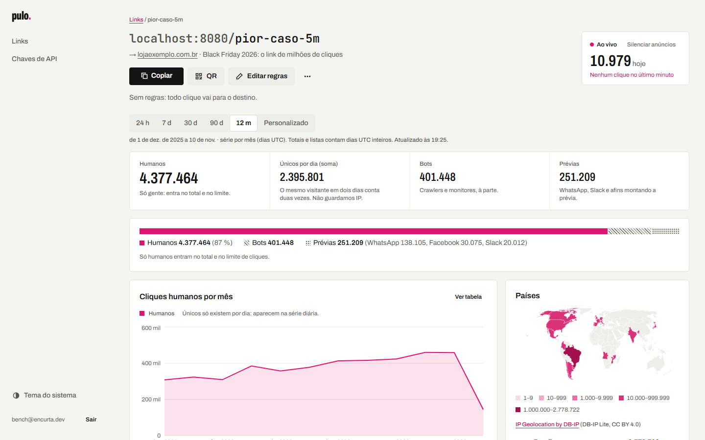
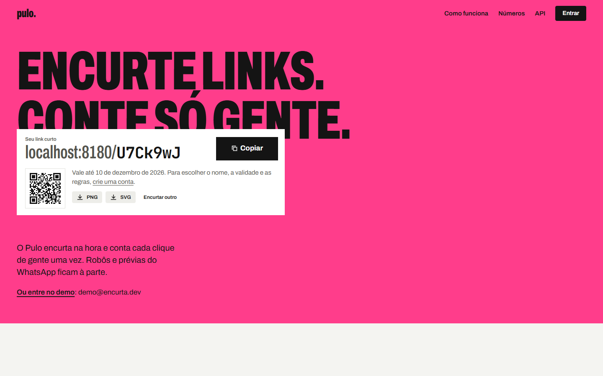
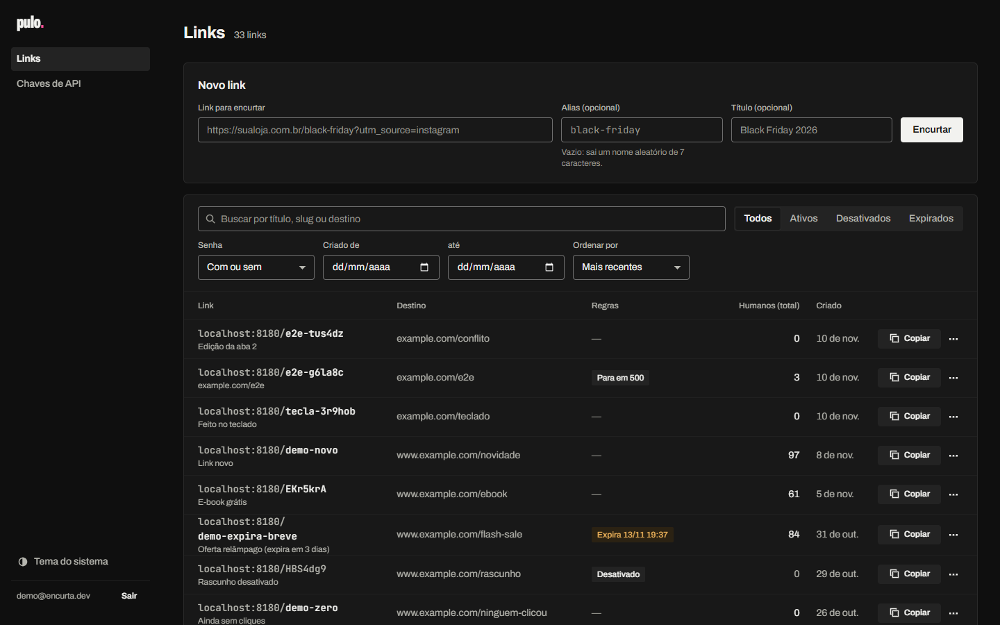
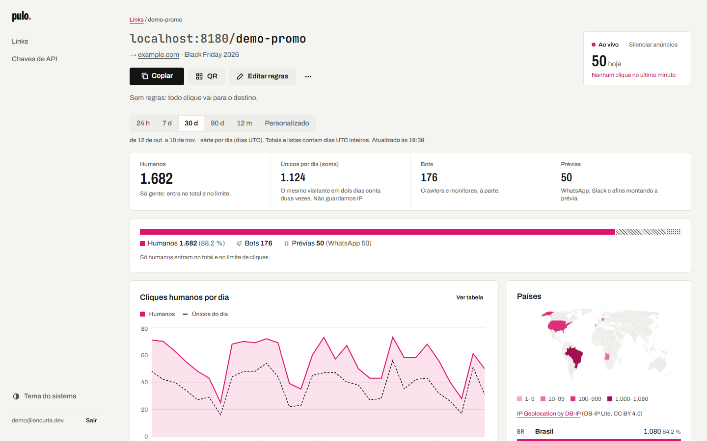
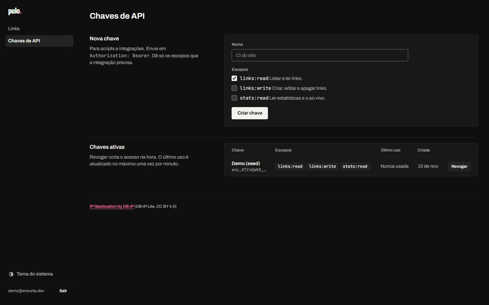
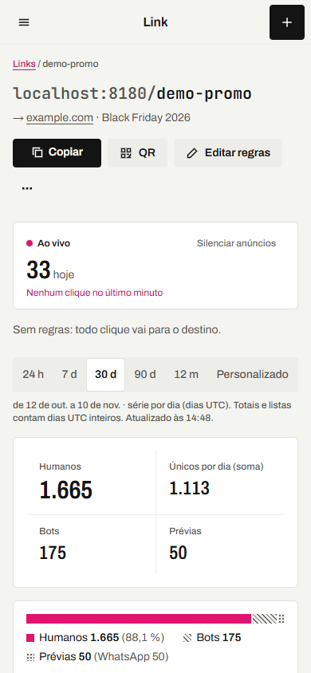
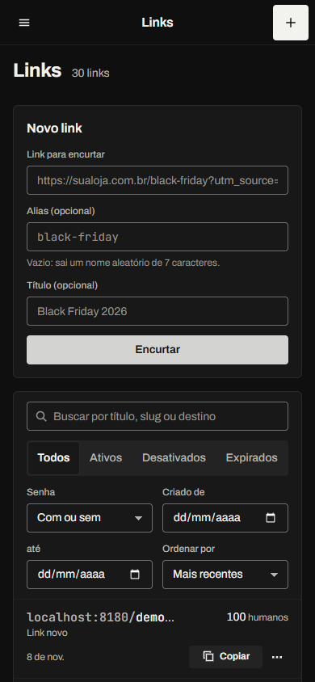
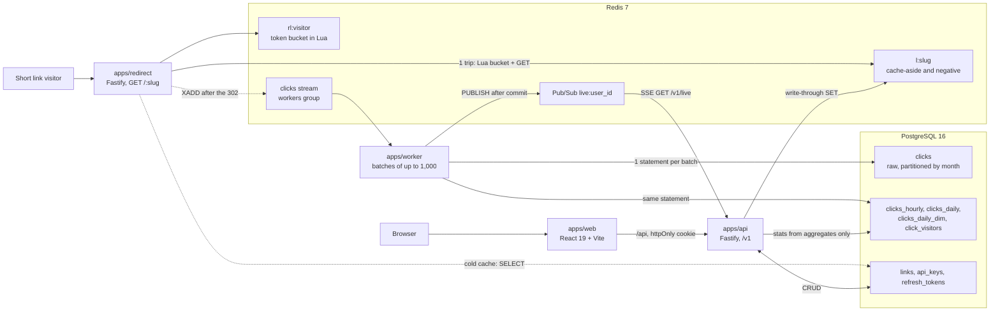
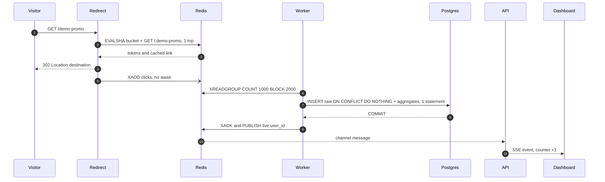

# Pulo: the redirect answers in 6.42 ms at p95 and a link's dashboard reads 5 million clicks in under 1 ms

[Versão em português](README.md)



Pulo is a URL shortener with analytics. It swaps a long link for a short one, decides where each click
goes (expiry, password, click cap, country, device, redirect type) and counts those clicks exactly: each
human click once, with bots and WhatsApp previews kept apart. The project demonstrates four things,
each with a decision recorded in an ADR and a measured number:

- **Unique IDs without coordination:** a random 7-character base62 slug, with uniqueness decided by the
  Postgres unique index (`ON CONFLICT`), with no `SELECT` before the `INSERT`.
- **Fast redirect:** **6.42 ms** p95 with cache, 10,129 req/s in one process, 1 trip to Redis and 0 to
  Postgres; the click is recorded after the response.
- **Exactly-once pipeline:** Redis Streams, a worker that is idempotent on the event id, and aggregates
  written in the same statement as the raw row.
- **Queries over many clicks:** with 5 M clicks, the dashboard reads only aggregates and answers in
  **0.19–0.59 ms** per link (against 28–122 ms for a `COUNT` on the raw table, warm).

The interface is in Brazilian Portuguese, and so are the ADRs and the other docs; this README is the
English entry point.

## Contents

[Screens](#screens) · [Run in 3 commands](#run-in-3-commands) · [Architecture](#architecture) ·
[Performance](#performance) · [Unique IDs](#1-unique-ids-without-coordination) ·
[Fast redirect](#2-fast-redirect) · [Exactly once](#3-exactly-once-pipeline) ·
[Many clicks](#4-queries-over-many-clicks) · [API](#api) · [Privacy](#privacy-lgpd) ·
[Tests](#tests) · [Decisions](#decisions) · [Design](#design) · [Structure](#structure) ·
[Credits and license](#credits-and-license)

## Screens

|                                                                                                                                                                                                           |                                                                                                                                                                     |
| --------------------------------------------------------------------------------------------------------------------------------------------------------------------------------------------------------- | ------------------------------------------------------------------------------------------------------------------------------------------------------------------- |
|  |  |
| **Landing.** Shortens without an account; the short link is born as a strip pasted onto the poster.                                                                                                       | **Dashboard (dark).** Search, filters, sorting and cursor pagination.                                                                                               |
|                                                                                        |                                                |
| **Link page.** Live counter over SSE, and only humans in the total.                                                                                                                                       | **API keys.** Visible prefix, scopes, and the secret shown once.                                                                                                    |
|                                                                                                                        |                                                                               |
| **On a phone.** The same screens at 390 px.                                                                                                                                                               | **Phone, dark.** A complete theme with the same color roles.                                                                                                        |

The top capture is the real worst case: the `pior-caso-5m` link, with about 5 M clicks generated by the
big seed, opened in the dashboard. All 18 captures are in [`docs/screenshots/`](docs/screenshots/).

## Run in 3 commands

Prerequisites: Git, Docker and Node 22 (pnpm comes from corepack, no global install).

```bash
git clone <repository-url> encurtador && cd encurtador
docker compose up -d --wait
corepack pnpm install && corepack pnpm demo
```

`demo` ([`scripts/demo.mjs`](scripts/demo.mjs)) creates `.env` from `.env.example` (if it does not
exist), applies the migrations (`drizzle-kit migrate`), runs `seed:demo` and starts redirect, API,
worker and web together. When all four respond, it prints:

| What                  | Where                            |
| --------------------- | -------------------------------- |
| Landing and dashboard | http://localhost:5173            |
| Sign in               | http://localhost:5173/entrar     |
| API and OpenAPI       | http://localhost:3000/docs       |
| A test redirect       | http://localhost:8080/demo-promo |
| Worker metrics        | http://localhost:9464/metrics    |

Demo account: **`demo@encurta.dev` / `demo1234`**, with 30 varied links (password, expired, disabled,
exhausted, country and device rules, long title, emoji) and 90 days of synthetic clicks. On the first
run the seed also prints an API key with every scope (it is shown only that once). Ctrl+C stops
everything.

**Optional:** `corepack pnpm geo:download` fetches the DB-IP Lite databases (about 64 MB compressed)
into `data/geo/`. Without them everything works, but the country and city of new clicks stay
"unknown".

Postgres 16 and Redis 7 run on ports **5433** and **6380** ([D-01](docs/decisoes.md)). The app ports
come from `.env` (`REDIRECT_PORT`, `API_PORT`, `WEB_PORT`, `WORKER_METRICS_PORT`) and can be overridden
with environment variables.

## Architecture



The path of a click, from the `GET` to the live counter:



- **pnpm monorepo** with four apps and four packages. `packages/shared` does no I/O: slug generator,
  destination validation, bot and preview classification, Zod schemas. `packages/db` holds the Drizzle
  schema, the SQL migrations and the stats queries.
- **The redirect does not depend on Postgres on the hot path.** With cache it makes 1 trip to Redis and
  0 to the database. If Redis goes down it serves from Postgres, without rate limiting, with a metric
  and an alert log: losing a click is acceptable, taking a redirect down is not
  ([ADR 0002](docs/adr/0002-redirect.md)).
- **The dashboard never runs `COUNT` on the raw table.** The API reads `clicks_hourly`, `clicks_daily`
  and `clicks_daily_dim`, which the worker maintains in the same transaction as the raw table
  ([ADR 0006](docs/adr/0006-agregados-como-fonte-do-dashboard.md)).

**Stack:** Node 22, TypeScript 6.0, pnpm 10 · Fastify 5, Drizzle ORM 0.45, postgres.js, ioredis, Zod 4,
jose, argon2 · PostgreSQL 16, Redis 7 · React 19, Vite 8, TanStack Router and Query, Base UI,
Recharts 3, d3-geo · Vitest 5, fast-check 4, Playwright 1.65 with axe-core, autocannon.

## Performance

Everything measured on one machine: AMD Ryzen 5 5500 (6 cores, 12 threads), 15.9 GB, Windows 11, Node
22.14, Postgres and Redis on Docker Desktop (WSL2). Full method, plans and limitations in
[`docs/performance.md`](docs/performance.md).

**Redirect** (`corepack pnpm bench:redirect`): autocannon with 50 connections, 5 s warm-up and 30 s of
measurement, mean of 2 runs. The Lua bucket and the XADD run on every request.

| Scenario                                    |  req/s |     p50 |         p95 |      p99 |
| ------------------------------------------- | -----: | ------: | ----------: | -------: |
| Cached, 1 Redis trip (Lua bucket + GET)     | 10,129 | 4.64 ms | **6.42 ms** |  7.75 ms |
| Cached, 2 trips (bucket and GET separately) |  8,921 | 5.22 ms |     7.29 ms |  9.05 ms |
| No cache (`SELECT` on Postgres)             |  7,891 | 5.98 ms |     8.09 ms | 10.02 ms |
| Negative cache (unknown slug, 404)          | 16,090 | 2.95 ms |     4.48 ms |  5.79 ms |

The target was p95 < 20 ms with cache. The latency is almost all queueing: by Little's law, 50
connections / 10 thousand req/s = 5 ms, which is the measured p50.

**Analytics with 5 M clicks** (`corepack pnpm seed:big` and `corepack pnpm bench:analytics`):
`EXPLAIN (ANALYZE, BUFFERS)`; warm = p50 of 5 runs, cold = median of 3 with Postgres restarted and the
VM page cache dropped before each one. The hot link has 612,097 clicks.

| Query                     | `COUNT` on raw, warm / cold | Best raw index, warm / cold | Aggregates, warm / cold | Speed-up warm / cold |
| ------------------------- | --------------------------: | --------------------------: | ----------------------: | -------------------: |
| 30-day series, hot link   |               61.9 / 359 ms |              21.6 / 56.8 ms |       **0.21 / 6.0 ms** |           295× / 60× |
| 30-day series, cold link  |               28.4 / 343 ms |                           — |       **0.19 / 3.6 ms** |           150× / 95× |
| Top 10 countries, 90 days |                122 / 823 ms |               30.4 / 102 ms |      **0.59 / 18.0 ms** |           207× / 46× |
| Uniques vs totals, 30 d   |               83.2 / 388 ms |              39.4 / 78.8 ms |       **0.19 / 4.6 ms** |           440× / 84× |
| Account, 12-month series  |              448 / 2,540 ms |              612 / 3,230 ms |       **4.22 / 319 ms** |            106× / 8× |

The "best index" is `(link_id, occurred_at) INCLUDE (kind, visitor, country)` on the partitioned raw
table: 327 MB and +55 % WAL per insert, and still 50–100× slower than the aggregates when warm.

## The four theses

### 1. Unique IDs without coordination

Decision in [ADR 0001](docs/adr/0001-geracao-de-slugs.md): **7 base62 characters drawn with
`crypto.randomBytes`, and the unique index decides.** A counter with Sqids was rejected because it is
enumerable and leaks volume; Snowflake, because it gives 11 characters and requires handing out worker
ids.

**The collision math.** The space is `62^7 = 3.52 × 10¹²` (about 41.7 bits). With `n = 10⁹` links
already stored, a new draw collides with `p = 2.84 × 10⁻⁴`, and the expected cost is
`1 / (1 − p) ≈ 1.0003` inserts per link. By the birthday paradox, 10⁶ draws have a 13.2 % chance of
containing some collision (0.14 expected pairs): collisions **will** happen, so the database check is
mandatory. To avoid modulo bias (`256 = 4 × 62 + 8`), bytes ≥ 248 are discarded.

```sql
INSERT INTO links (slug, user_id, destination, ...)
VALUES ($1, $2, $3, ...)
ON CONFLICT (slug) DO NOTHING
RETURNING id;   -- zero rows = collision: draw another, up to 5 times (from the 4th on, 8 characters)
```

The index is `UNIQUE (slug COLLATE "C")`: slugs are case-sensitive, otherwise the space would drop to
`36^7`. With no `SELECT` first, two requests drawing the same slug produce one success and one retry.
Deleted links keep their slug forever, because reusing a slug printed on a QR code would be phishing.

| Proof                                                 | Result                                                                                  |
| ----------------------------------------------------- | --------------------------------------------------------------------------------------- |
| 1,000,000 slugs (property)                            | 739–857 ms; repeated pairs 0, 0, 0, 1, 0, 1, 0, 0, 0 over 9 runs (0.14 expected)        |
| Per-position chi-square against bias                  | 37.98–83.50 with 61 d.f.; the `byte % 62` mutant gives χ² ≈ 6,400–6,900 and is rejected |
| 50 concurrent `createLink` in a space of only 8 slugs | 8 ok, 42 `SlugExhaustedError`, 8 distinct slugs                                         |
| 20 concurrent requests for the same alias             | 1 × 201 and 19 × 409                                                                    |
| Batch of 1,000 items                                  | 1 `INSERT`                                                                              |

**The deadlock the Validator found.** Phase 1 was done as a trio (Executor, Planner and an independent
Validator trying to break the code). Two simultaneous batches carrying the same 200 aliases in opposite
orders deadlocked (`40P01`) in 1 of 40 batches, because each transaction locks the unique-index keys in
`VALUES` order. The fix was to sort each batch round by code point, which is the `COLLATE "C"` order:
without the sort the test fails 3 out of 3 times; with it, it passes 3 out of 3
([`deadlock.test.ts`](packages/db/test/integration/deadlock.test.ts)).

### 2. Fast redirect

Decision in [ADR 0002](docs/adr/0002-redirect.md). Result: **6.42 ms p95 and 10,129 req/s** with
cache.

- **302 by default.** A 301 without `Cache-Control` stays in the browser indefinitely: the return click
  is not counted and editing the destination has no effect. The type is configurable per link (301,
  302, 307, 308); 301 and 308 go out with the link's `max-age` (3,600 s by default), not forever.
- **Cache-aside with race-free write-through.** Readers fill `l:<slug>` with `SET NX`; the API, after
  the commit, writes with an unconditional `SET` (the new value, or `∅` if the link was deleted). If a
  late reader tries to write the old value back, its `NX` fails; if it writes first, the API overwrites
  it. A plain `DEL` would let the old value come back for up to 1 h.
- **Negative cache** for 30 s: a bot sweeping random slugs hits Redis (16,090 req/s, 4.48 ms p95), not
  Postgres. **Single-flight** per slug: 1,000 requests to a cold slug make 1 query.
- **Lua in one trip.** The same script runs the visitor's token bucket and the link `GET`: +13.5 %
  req/s compared with two trips (10,129 vs 8,921).
- **The event goes out without waiting.** The response goes first; then
  `XADD clicks MAXLEN ~ 1000000` without `await`. If Redis goes down, a 10,000-event buffer holds and
  resends.
- **Rules in the right order:** format and reserved words, bucket, cache, disabled, expired (410),
  password (argon2id, 5 attempts per minute), click cap (atomic `INCR`, which **bots and previews do
  not consume**), country and device rules, query forwarding without overwriting the owner's UTMs.
- **Destination validated in the API:** only `http:` and `https:`, no credentials in the URL, no
  private IP (including `0x7f.1`, `[::ffff:127.0.0.1]`), no loop back to our own domains. The Validator
  tried about 100 attacks; the holes it found are in the ADR.

### 3. Exactly-once pipeline

Decision in [ADR 0003](docs/adr/0003-pipeline-de-cliques.md): **Redis Streams with a consumer group**,
the only transport on the list with ACK, redelivery and load balancing without new infrastructure. The
worker reads up to 1,000 events or 500 ms and writes everything in a single statement with CTEs:

- the raw row goes in with `ON CONFLICT (occurred_at, event_id) DO NOTHING RETURNING *`;
- **the aggregates only add what `RETURNING` gave back**, so a redelivered event adds nowhere, and a
  crash between `COMMIT` and `XACK` does not double count;
- `ORDER BY` the key on each aggregate upsert, so the workers take locks in the same order.

`occurred_at` comes from the 48 time bits of the UUIDv7 generated in the redirect: the same event
always lands in the same partition and on the same key.

**What the independent Validator broke** (phase 3, as a trio). Two serious flaws in the first design
and four minor ones, all fixed and turned into regressions in
[`regressions.test.ts`](apps/worker/test/integration/regressions.test.ts):

| Problem                                                                                                      | Before                                      | Fix                                                                                                                                     | After                     |
| ------------------------------------------------------------------------------------------------------------ | ------------------------------------------- | --------------------------------------------------------------------------------------------------------------------------------------- | ------------------------- |
| With Postgres slow, the reclaim grabbed messages from the batch in progress and sent valid events to `:dead` | 3,000 events produced 5,477 `:dead` entries | `inFlight` ids with a heartbeat (`XCLAIM … JUSTID`); `XPENDING IDLE` + `XCLAIM` instead of `XAUTOCLAIM`; `:dead` only for real failures | `:dead` = 0, exact counts |
| The same `event_id` with a different `ts` landed on another key                                              | 3 rows                                      | `occurred_at` comes from the UUIDv7; `ts` is only checked                                                                               | 1 row                     |
| Stream or group deleted in Redis                                                                             | `NOGROUP` in an endless loop                | every stream command recreates the group and goes on                                                                                    | events processed          |
| Click on a deleted link counted as a duplicate                                                               | `duplicates:2`                              | the statement tells an unknown link apart from a duplicate                                                                              | `duplicates:0`            |
| `android-app://joao:senha@…` and country `XX` stored                                                         | stored                                      | package validation, `(ip)` for a literal-IP referrer, `normalizeCountry`                                                                | clean                     |
| `stop()` hanging with Postgres stuck on a lock                                                               | never returned                              | 30 s `statement_timeout` and a deadline in `stop()`                                                                                     | < 1.5 s                   |

After the fix, 4 workers process 100,000 events in 12.7–14.6 s, with no deadlock in 7 runs.
`test:consistency` compares every aggregate with `COUNT` and `COUNT DISTINCT` on the raw table using
`EXCEPT ALL` in both directions, including with the real worker writing 3,000 events (plus 300
repeats) on top: 8 out of 8 with 5 M, with 7.4 M and with 50 thousand (in CI). Adding 1 to a single
`clicks_daily_dim` row makes 3 cases fail.

### 4. Queries over many clicks

Decisions in [ADR 0005](docs/adr/0005-particao-e-indices-da-bruta.md) and
[ADR 0006](docs/adr/0006-agregados-como-fonte-do-dashboard.md), measured with 5 M clicks over 12 months
(a 1.07 GB raw table) and one link with 612 thousand.

- **What solves it is not reading the raw table.** The aggregates are **150–440× faster warm** on the
  per-link queries and 106× on the account view. No index on the raw table comes close (table in
  [Performance](#performance)).
- **Monthly partitions, for retention rather than reads.** On per-link queries the partition ties with
  the composite index. But dropping a month with `DETACH` + `DROP` takes 86 + 54 ms and 0.2 MB of WAL,
  and the disk space comes back at once; with `DELETE` it is 383 ms plus 6.6 s of `VACUUM`, and the
  space only comes back with a 59.4 s `VACUUM FULL` that locks the table and writes 1.5 GB of WAL.
- **Indexes measured, not assumed.** The PK `(occurred_at, event_id)`, which also deduplicates, stays,
  and so does `(link_id, occurred_at)`, which costs about 11 % of the isolated `INSERT` and about 2 % of
  the worker batch. The "obvious" index can make things worse: on the account view it replaces the
  sequential scan (448 ms) with thousands of random reads (1.09 s warm, 12.1 s cold).
- **BRIN rejected, with numbers.** With correlation 1.0000 it is 40 kB against 107 MB for the btree
  (2,700× smaller), but it finds a day by reading 3.3× more rows: 6.35 ms against 3.41 ms warm and 92.6
  against 32.5 ms cold. The time PK already exists and partition pruning already cuts by month, so it
  would be redundant.
- **Covering index (INCLUDE) rejected:** 327 MB and +55 % WAL to speed up reads the product never
  makes. **pg_trgm postponed:** it only pays off for accounts with tens of thousands of links
  (76.2 → 0.72 ms with 44,655 links in one account), and the three GIN indexes end up larger than the
  table.
- **`random_page_cost=1.1`** in Compose, because the volume is an SSD: the account view moves from a
  sequential scan to a nested loop over the index, from 29.2 to 4.2 ms warm.

The remaining weak spot is written down: the cold account view takes 319 ms. The next step would be a
per-user, per-day aggregate, not another index.

## API

27 operations under `/v1`, documented in OpenAPI and served by Swagger UI at
[`localhost:3000/docs`](http://localhost:3000/docs) (on the web app, `/api/docs/`). Contract in
[ADR 0004](docs/adr/0004-autenticacao-e-contrato-da-api.md):

- **Errors as `application/problem+json`** (RFC 9457), with per-field `errors[]` on 422s.
- **Cursor pagination** with an opaque cursor bound to the filters and the sort (`created_at`,
  `clicks`, `title`, always with `id` as the tie-breaker).
- **`Idempotency-Key`** on POSTs that create something: same key and same body return the stored
  response (`Idempotent-Replayed: true`); a different body gives 422; still in progress gives 409.
- **ETag**: weak on reads (304) and strong on `PATCH` with `If-Match` (412 if another tab edited first).
- **Scopes** `links:read`, `links:write` and `stats:read`; without the scope, 403 `insufficient_scope`.
- **Authentication:** the dashboard uses a 15-minute JWT kept in memory and an opaque refresh token in
  an httpOnly cookie, with rotation and reuse detection. Integrations use `enc_<prefix>_<secret>` keys,
  stored only as SHA-256 and shown once.
- **Rate limiting** with the same Lua token bucket, `RateLimit-*` headers and `Retry-After` on 429.
- **Live updates** over SSE with a single-use ticket, so the JWT never ends up in a URL.

Example with the API key that `seed:demo` prints (create a link and read its stats):

```bash
KEY=enc_xxxxxxxx_xxxxxxxxxxxxxxxxxxxxxxxxxxxxxxxx

curl -i -X POST http://localhost:3000/v1/links \
  -H "Authorization: Bearer $KEY" \
  -H "Content-Type: application/json" \
  -H "Idempotency-Key: lancamento-1" \
  -d '{"destination":"https://example.com/lancamento?utm_source=newsletter","alias":"lancamento","title":"Lancamento"}'
# HTTP/1.1 201 Created
# location: /v1/links/31
# {"id":31,"slug":"lancamento","short_url":"http://localhost:8080/lancamento",...}

curl -s http://localhost:8080/lancamento -o /dev/null -A "Mozilla/5.0 (iPhone; CPU iPhone OS 17_0 like Mac OS X)"

curl -s http://localhost:3000/v1/links/31/stats/summary -H "Authorization: Bearer $KEY"
# {"link_id":31,"from":"2026-10-12","to":"2026-11-10","total":1,"humans":1,"uniques":1,
#  "unique_ratio":1,"bots":0,"previews":0,"preview_apps":[],"all_time_humans":1}
```

The `id` and the dates change from one install to another. The other stats live under
`/v1/links/{id}/stats/{timeseries,countries,cities,referrers,browsers,os,devices}`, and the account
view under `/v1/overview`.

## Privacy (LGPD)

Details in [ADR 0003](docs/adr/0003-pipeline-de-cliques.md#privacidade-lgpd). LGPD is Brazil's
data-protection law.

- **The IP is never stored.** It only exists in the redirect's memory during the request and leaves
  transformed into two things: `visitor`, an HMAC-SHA256 with the day's salt, and `ip_net`, truncated to
  /24 (IPv4) or /48 (IPv6), which the worker uses for geolocation and then discards. No column holds an
  IP, and a test checks it.
- **Daily salt** of 32 bytes in Redis, with a 48 h TTL. Once it expires, the stored hash can no longer
  be tied to an IP. Accepted consequence, stated in the interface: uniques are per day, and the same
  visitor on two days counts twice.
- **`X-Forwarded-For` only behind a trusted proxy** (`TRUST_PROXY=<CIDRs>`). Otherwise a client could
  forge its IP to dodge the rate limit and the uniques. Logs pass the IP and XFF through pino's
  `redact`.
- The referrer keeps only the domain, with no path.

## Tests

Numbers from the latest run (`corepack pnpm test` plus the integration and e2e suites, run in this
phase):

| Suite                                                                                                                      | Tests          | How to run                                                     |
| -------------------------------------------------------------------------------------------------------------------------- | -------------- | -------------------------------------------------------------- |
| `packages/shared` unit tests: slug (with 1 M slugs), destination, IP, reserved words, helpers; fast-check in 5 files       | 461 in 8 files | `corepack pnpm --filter @encurtador/shared test`               |
| Unit tests in the other packages (web 33, worker 21, bench 7, api 5, db 4, geo 3, redirect 2)                              | 75             | `corepack pnpm test` (runs all of them: 536)                   |
| `packages/db` integration (forced collision, alias race, batch deadlock, cache, query plans)                               | 42             | `corepack pnpm --filter @encurtador/db test:integration`       |
| `apps/redirect` integration (one rule per test, invalidation, destination bypasses, bucket)                                | 34             | `corepack pnpm --filter @encurtador/redirect test:integration` |
| `apps/worker` integration (redelivery, crash, 4 workers × 100,000, the Validator's regressions)                            | 25             | `corepack pnpm --filter @encurtador/worker test:integration`   |
| `apps/api` integration (every route, isolation between users via JWT and via key, OpenAPI)                                 | 68             | `corepack pnpm --filter @encurtador/api test:integration`      |
| Aggregates vs raw consistency (5 M, or 50 thousand in CI)                                                                  | 8              | `corepack pnpm seed:big` then `corepack pnpm test:consistency` |
| Playwright E2E against the real stack (API, redirect, worker and web): landing, dashboard, live, keys, offline             | 17             | `corepack pnpm test:e2e`                                       |
| … of which accessibility: axe with no WCAG 2.2 A/AA violations in light and dark (4), keyboard, 200 % zoom, reduced motion | 10             | same (`apps/web/e2e/a11y.spec.ts`)                             |

Integration and e2e need the Postgres and Redis from `docker compose`; each suite uses its own database
(`encurtador_test`, `encurtador_e2e`) and its own Redis db. The consistency suite was not rerun in this
phase, because `seed:big` recreates the `encurtador_bench` database; the 8 out of 8 is the one recorded
in [`docs/performance.md`](docs/performance.md#teste-de-consistência). CI
([`.github/workflows/ci.yml`](.github/workflows/ci.yml)) runs formatting, lint, typecheck, unit tests,
the four integration suites, the e2e, the CI-sized big seed with the consistency check, and `seed:demo`
twice (idempotent).

## Decisions

| ADR                                                        | Decision                                                                  |
| ---------------------------------------------------------- | ------------------------------------------------------------------------- |
| [0001](docs/adr/0001-geracao-de-slugs.md)                  | 7-character base62 slug, uniqueness through the index with `ON CONFLICT`  |
| [0002](docs/adr/0002-redirect.md)                          | 302 by default, rule order, cache-aside with write-through, bucket in Lua |
| [0003](docs/adr/0003-pipeline-de-cliques.md)               | Redis Streams, exactly once, daily salt with no IP                        |
| [0004](docs/adr/0004-autenticacao-e-contrato-da-api.md)    | short JWT + refresh cookie, scoped keys, HTTP contract                    |
| [0005](docs/adr/0005-particao-e-indices-da-bruta.md)       | monthly partitions, indexes kept, BRIN and INCLUDE rejected               |
| [0006](docs/adr/0006-agregados-como-fonte-do-dashboard.md) | aggregates as the dashboard's only source                                 |

The ADR index is in [`docs/adr/README.md`](docs/adr/README.md). Smaller decisions (ports, licenses,
front-end libraries, the name) are in [`docs/decisoes.md`](docs/decisoes.md), D-01 to D-08.

## Design

The name **Pulo** ("jump" in Portuguese) names the mechanism: the redirect's hop. The direction comes
from the **lambe-lambe poster of Brazilian print shops**, the medium local businesses use to announce
sales and openings:

- **the landing is the poster:** hot pink, condensed all-caps Archivo, and the paper strip pasted on
  with the URL field;
- **the app is the ledger:** achromatic, tabular figures, and pink only where the data matters, on
  human clicks and the live indicator;
- **the honest bar** shows humans, bots and previews in a single bar, with the sentence "Só humanos
  entram no total e no limite de cliques" (only humans count toward the total and the click cap).

The system (tokens, components, checked contrast) is in [`DESIGN.md`](DESIGN.md), the product context
in [`PRODUCT.md`](PRODUCT.md) and the origin of the direction in
[`docs/design/direcao.md`](docs/design/direcao.md). The polish phase (worst case with 5 M clicks,
animation review, audit and accessibility) is in [`docs/polimento.md`](docs/polimento.md).

## Structure

```
apps/
  redirect/       GET /:slug: rules, cache, Lua bucket, XADD after the response
  api/            /v1: auth, keys, links, stats, SSE, preview, OpenAPI and the demo seed
  worker/         consumes the stream, enriches (geo, user agent), writes raw + aggregates
  web/            React + Vite: landing, dashboard, link page, keys; e2e/ with Playwright
packages/
  shared/         no I/O: slug, destination validation, reserved words, bot classification
  db/             Drizzle schema, SQL migrations (drizzle/), stats queries, cache
  geo/            reads the DB-IP databases (mmdb)
  bench/          big seed, analytics, write, trigram, retention and consistency benches
scripts/          demo.mjs, bench-redirect.ts, geo-download.ts
docs/             ADRs, performance, polish, decisions, design and screenshots
```

## Credits and license

- **IP Geolocation by [DB-IP](https://db-ip.com)**: the DB-IP Lite databases (City and Country) are
  distributed under [CC BY 4.0](https://creativecommons.org/licenses/by/4.0/). They are not in the
  repository; `corepack pnpm geo:download` fetches the files.
- Main libraries: [Fastify](https://fastify.dev), [Drizzle ORM](https://orm.drizzle.team),
  [postgres.js](https://github.com/porsager/postgres), [ioredis](https://github.com/redis/ioredis),
  [Zod](https://zod.dev), [jose](https://github.com/panva/jose),
  [@node-rs/argon2](https://github.com/napi-rs/node-rs), [maxmind](https://github.com/runk/node-maxmind),
  [ua-parser-js](https://github.com/faisalman/ua-parser-js) 1.x (MIT),
  [isbot](https://github.com/omrilotan/isbot), [pino](https://getpino.io),
  [prom-client](https://github.com/siimon/prom-client), [React](https://react.dev),
  [Vite](https://vite.dev), [TanStack Router and Query](https://tanstack.com),
  [Base UI](https://base-ui.com), [Recharts](https://recharts.org),
  [d3-geo](https://github.com/d3/d3-geo), [world-atlas](https://github.com/topojson/world-atlas),
  [Sonner](https://sonner.emilkowal.ski), [Zustand](https://github.com/pmndrs/zustand),
  [qrcode](https://github.com/soldair/node-qrcode), the Archivo and JetBrains Mono fonts via
  [Fontsource](https://fontsource.org), [Vitest](https://vitest.dev),
  [fast-check](https://fast-check.dev), [Playwright](https://playwright.dev),
  [axe-core](https://github.com/dequelabs/axe-core) and
  [autocannon](https://github.com/mcollina/autocannon).

A portfolio project, the third of four. **License: to be decided.** The repository has no license file
yet.
