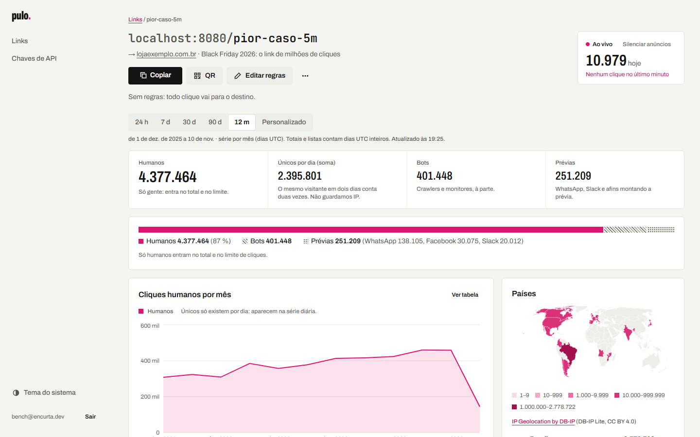
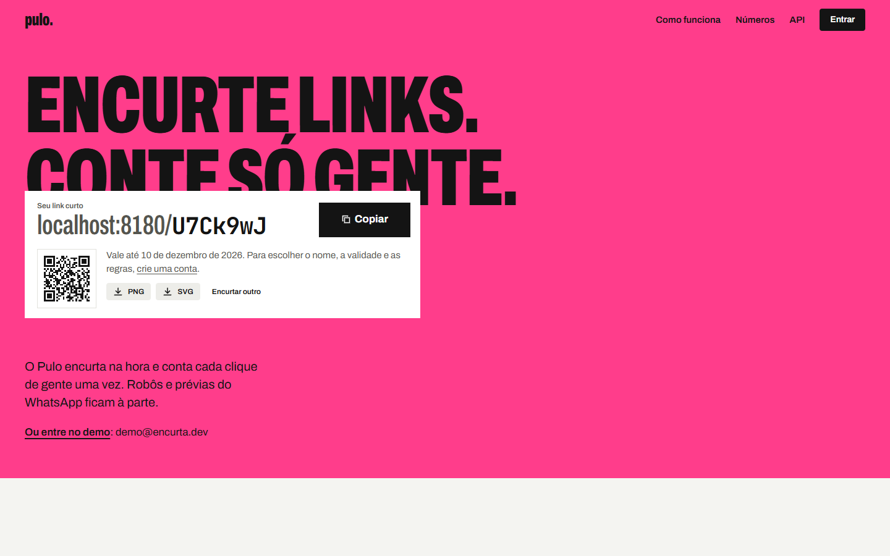
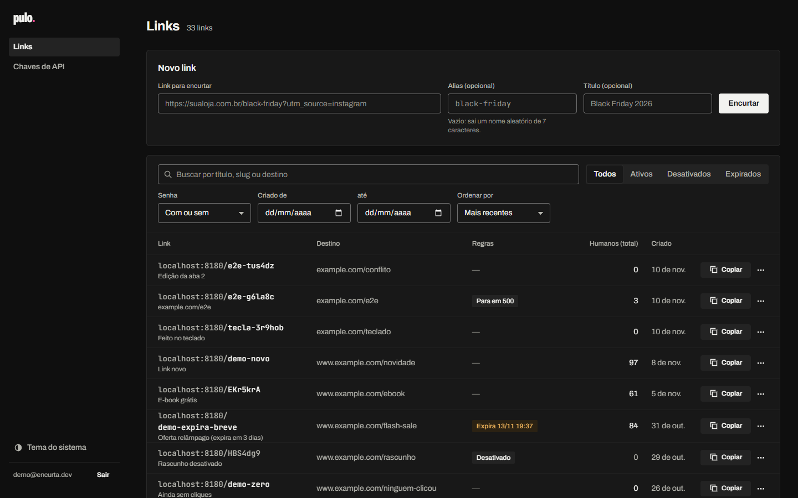
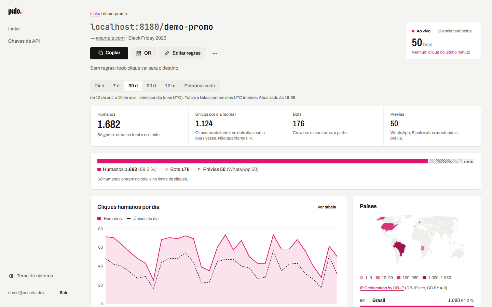
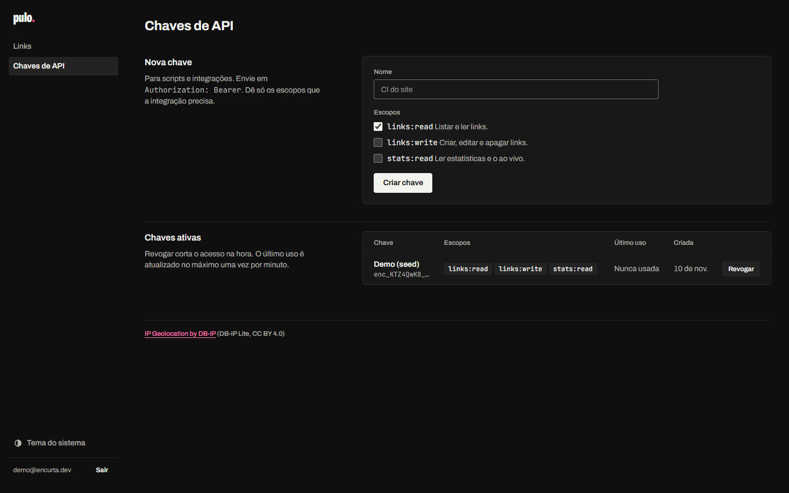
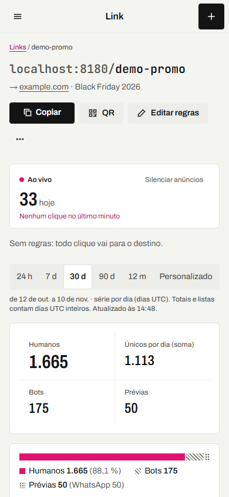
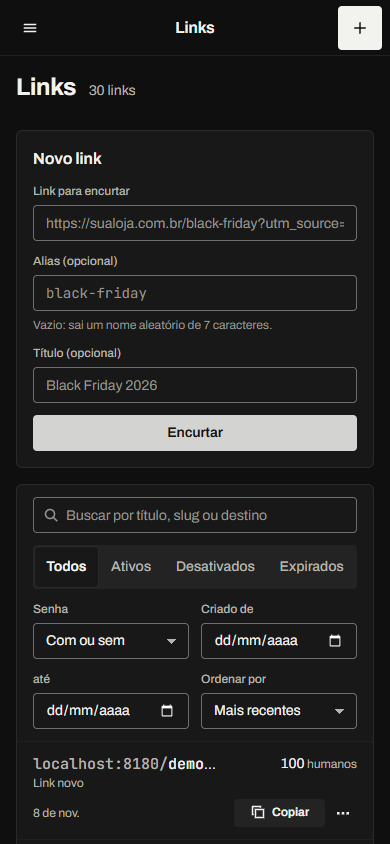
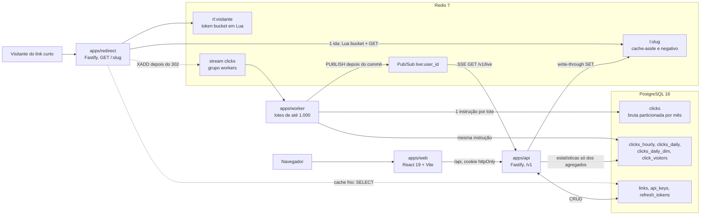
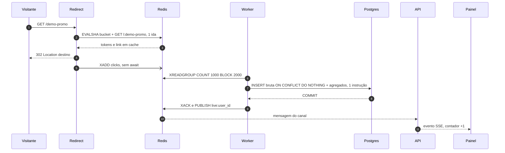

# Pulo: o redirect responde em 6,42 ms no p95 e o painel de um link lê 5 milhões de cliques em menos de 1 ms

[English version](README.en.md)



O Pulo é um encurtador de URLs com analytics. Ele troca um link longo por um curto, decide para onde
cada clique vai (prazo, senha, limite de cliques, país, dispositivo, tipo de redirect) e conta esses
cliques com exatidão: cada clique humano uma vez, com robôs e prévias de WhatsApp à parte. O projeto
demonstra quatro coisas, cada uma com uma decisão registrada em ADR e um número medido:

- **IDs únicos sem coordenação:** slug aleatório de 7 caracteres em base62, com a unicidade decidida
  pelo índice único do Postgres (`ON CONFLICT`), sem `SELECT` antes do `INSERT`.
- **Redirect rápido:** p95 de **6,42 ms** com cache, 10.129 req/s num processo, 1 ida ao Redis e 0 ao
  Postgres; o clique é registrado depois da resposta.
- **Pipeline exatamente uma vez:** Redis Streams, worker idempotente pelo id do evento e agregados
  gravados na mesma instrução que a linha bruta.
- **Consultas sobre muitos cliques:** com 5 M de cliques, o painel lê só agregados e responde em
  **0,19–0,59 ms** por link (contra 28–122 ms do `COUNT` na tabela bruta, quente).

## Sumário

[Telas](#telas) · [Rodar em 3 comandos](#rodar-em-3-comandos) · [Arquitetura](#arquitetura) ·
[Desempenho](#desempenho) · [IDs únicos](#1-ids-únicos-sem-coordenação) ·
[Redirect rápido](#2-redirect-rápido) · [Exatamente uma vez](#3-pipeline-exatamente-uma-vez) ·
[Muitos cliques](#4-consultas-sobre-muitos-cliques) · [API](#api) ·
[Privacidade](#privacidade-lgpd) · [Testes](#testes) · [Decisões](#decisões) · [Design](#design) ·
[Estrutura](#estrutura) · [Créditos e licença](#créditos-e-licença)

## Telas

|                                                                                                                                                                                         |                                                                                                                                                                            |
| --------------------------------------------------------------------------------------------------------------------------------------------------------------------------------------- | -------------------------------------------------------------------------------------------------------------------------------------------------------------------------- |
|  |  |
| **Landing.** Encurta sem conta; o link curto nasce como uma tira colada no cartaz.                                                                                                      | **Painel (escuro).** Busca, filtros, ordenação e paginação por cursor.                                                                                                     |
|                                                          |                                                 |
| **Página do link.** Contador ao vivo por SSE e só humanos no total.                                                                                                                     | **Chaves de API.** Prefixo visível, escopos e o segredo mostrado uma vez.                                                                                                  |
|                                                                                                 |                                                                                |
| **No celular.** As mesmas telas em 390 px.                                                                                                                                              | **Celular, escuro.** Um tema completo, com os mesmos papéis de cor.                                                                                                        |

A captura do topo é o pior caso de verdade: o link `pior-caso-5m`, com cerca de 5 M de cliques
gerados pelo seed grande, aberto no painel. As 18 capturas estão em
[`docs/screenshots/`](docs/screenshots/).

## Rodar em 3 comandos

Pré-requisitos: Git, Docker e Node 22 (o pnpm vem do corepack, sem instalação global).

```bash
git clone https://github.com/Felixdario/Pulo.git pulo && cd pulo
docker compose up -d --wait
corepack pnpm install && corepack pnpm demo
```

O `demo` ([`scripts/demo.mjs`](scripts/demo.mjs)) cria o `.env` a partir do `.env.example` (se não
existir), aplica as migrações (`drizzle-kit migrate`), roda o `seed:demo` e sobe redirect, API, worker
e web juntos. Quando os quatro respondem, ele imprime:

| O quê                   | Onde                             |
| ----------------------- | -------------------------------- |
| Landing e painel        | http://localhost:5173            |
| Entrar                  | http://localhost:5173/entrar     |
| API e OpenAPI (Swagger) | http://localhost:3000/docs       |
| Um redirect de teste    | http://localhost:8080/demo-promo |
| Métricas do worker      | http://localhost:9464/metrics    |

Conta demo: **`demo@encurta.dev` / `demo1234`**, com 30 links variados (senha, expirado, desativado,
esgotado, regra de país e de aparelho, título longo, emoji) e 90 dias de cliques sintéticos. Na
primeira execução, o seed também imprime uma chave de API com todos os escopos (ela aparece só nessa
vez). Ctrl+C encerra tudo.

**Opcional:** `corepack pnpm geo:download` baixa as bases DB-IP Lite (cerca de 64 MB compactados)
para `data/geo/`. Sem elas, tudo funciona, mas país e cidade dos cliques novos ficam "desconhecido".

Postgres 16 e Redis 7 sobem nas portas **5433** e **6380** ([D-01](docs/decisoes.md)). As portas dos
apps vêm do `.env` (`REDIRECT_PORT`, `API_PORT`, `WEB_PORT`, `WORKER_METRICS_PORT`) e podem ser
trocadas por variável de ambiente.

## Arquitetura



O caminho de um clique, do `GET` ao contador ao vivo:



- **Monorepo pnpm** com quatro apps e quatro pacotes. `packages/shared` não faz I/O: gerador de slug,
  validação de destino, classificação de robôs e prévias, schemas Zod. `packages/db` tem o schema
  Drizzle, as migrações SQL e as consultas de estatística.
- **O redirect não depende do Postgres no caminho quente.** Com cache, faz 1 ida ao Redis e 0 ao
  banco. Se o Redis cair, ele serve pelo Postgres, sem rate limit, com métrica e log de alerta: perder
  um clique é aceitável, derrubar um redirect não ([ADR 0002](docs/adr/0002-redirect.md)).
- **O dashboard nunca faz `COUNT` na bruta.** A API lê `clicks_hourly`, `clicks_daily` e
  `clicks_daily_dim`, que o worker mantém na mesma transação da bruta
  ([ADR 0006](docs/adr/0006-agregados-como-fonte-do-dashboard.md)).

**Stack:** Node 22, TypeScript 6.0, pnpm 10 · Fastify 5, Drizzle ORM 0.45, postgres.js, ioredis,
Zod 4, jose, argon2 · PostgreSQL 16, Redis 7 · React 19, Vite 8, TanStack Router e Query, Base UI,
Recharts 3, d3-geo · Vitest 5, fast-check 4, Playwright 1.65 com axe-core, autocannon.

## Desempenho

Tudo medido numa máquina só: AMD Ryzen 5 5500 (6 núcleos, 12 threads), 15,9 GB, Windows 11, Node
22.14, Postgres e Redis no Docker Desktop (WSL2). Método completo, planos e limitações em
[`docs/performance.md`](docs/performance.md).

**Redirect** (`corepack pnpm bench:redirect`): autocannon com 50 conexões, 5 s de aquecimento e 30 s
de medição, média de 2 rodadas. Bucket Lua e XADD rodam em toda requisição.

| Cenário                                      |  req/s |     p50 |         p95 |      p99 |
| -------------------------------------------- | -----: | ------: | ----------: | -------: |
| Com cache, 1 ida ao Redis (Lua bucket + GET) | 10.129 | 4,64 ms | **6,42 ms** |  7,75 ms |
| Com cache, 2 idas (bucket e GET separados)   |  8.921 | 5,22 ms |     7,29 ms |  9,05 ms |
| Sem cache (`SELECT` no Postgres)             |  7.891 | 5,98 ms |     8,09 ms | 10,02 ms |
| Cache negativo (slug inexistente, 404)       | 16.090 | 2,95 ms |     4,48 ms |  5,79 ms |

A meta era p95 < 20 ms com cache. A latência é quase toda fila: pela Lei de Little, 50 conexões /
10 mil req/s = 5 ms, que é o p50 medido.

**Analytics com 5 M de cliques** (`corepack pnpm seed:big` e `corepack pnpm bench:analytics`):
`EXPLAIN (ANALYZE, BUFFERS)`, quente = p50 de 5 execuções, frio = mediana de 3 com o Postgres
reiniciado e o page cache da VM esvaziado antes de cada uma. O link quente tem 612.097 cliques.

| Consulta                 | `COUNT` na bruta, quente / frio | Melhor índice na bruta, quente / frio | Agregados, quente / frio | Ganho quente / frio |
| ------------------------ | ------------------------------: | ------------------------------------: | -----------------------: | ------------------: |
| Série 30 d, link quente  |                   61,9 / 359 ms |                        21,6 / 56,8 ms |        **0,21 / 6,0 ms** |          295× / 60× |
| Série 30 d, link frio    |                   28,4 / 343 ms |                                     — |        **0,19 / 3,6 ms** |          150× / 95× |
| Top 10 países, 90 d      |                    122 / 823 ms |                         30,4 / 102 ms |       **0,59 / 18,0 ms** |          207× / 46× |
| Únicos × totais, 30 d    |                   83,2 / 388 ms |                        39,4 / 78,8 ms |        **0,19 / 4,6 ms** |          440× / 84× |
| Conta, série de 12 meses |                  448 / 2.540 ms |                        612 / 3.230 ms |        **4,22 / 319 ms** |           106× / 8× |

O "melhor índice" é o `(link_id, occurred_at) INCLUDE (kind, visitor, country)` na bruta
particionada: 327 MB e +55 % de WAL por inserção, e ainda 50–100× mais lento que os agregados quente.

## As quatro teses

### 1. IDs únicos sem coordenação

Decisão em [ADR 0001](docs/adr/0001-geracao-de-slugs.md): **7 caracteres base62 sorteados com
`crypto.randomBytes`, e o índice único decide.** Contador com Sqids foi recusado porque é enumerável e
vaza volume; Snowflake, porque dá 11 caracteres e exige distribuir worker ids.

**A conta da colisão.** O espaço é `62^7 = 3,52 × 10¹²` (cerca de 41,7 bits). Com `n = 10⁹` links já
gravados, um sorteio novo colide com `p = 2,84 × 10⁻⁴`, e o custo esperado é `1 / (1 − p) ≈ 1,0003`
insert por link. Pelo paradoxo do aniversário, com 10⁶ sorteios há 13,2 % de chance de existir alguma
colisão (0,14 par esperado): colisões **vão** acontecer, então a checagem no banco é obrigatória. Para
não ter viés de módulo (`256 = 4 × 62 + 8`), bytes ≥ 248 são descartados.

```sql
INSERT INTO links (slug, user_id, destination, ...)
VALUES ($1, $2, $3, ...)
ON CONFLICT (slug) DO NOTHING
RETURNING id;   -- zero linhas = colisão: sorteia outro, até 5 vezes (da 4ª em diante, 8 caracteres)
```

O índice é `UNIQUE (slug COLLATE "C")`: slugs diferenciam maiúsculas, senão o espaço cairia para
`36^7`. Sem `SELECT` antes, duas requisições que sorteiam o mesmo slug dão um sucesso e uma nova
tentativa. Links apagados continuam ocupando o slug, porque reaproveitar um slug impresso num QR seria
phishing.

| Prova                                                 | Resultado                                                                            |
| ----------------------------------------------------- | ------------------------------------------------------------------------------------ |
| 1.000.000 de slugs (propriedade)                      | 739–857 ms; pares repetidos 0, 0, 0, 1, 0, 1, 0, 0, 0 em 9 execuções (esperado 0,14) |
| Qui-quadrado por posição contra viés                  | 37,98–83,50 com 61 g.l.; o mutante `byte % 62` dá χ² ≈ 6.400–6.900 e é reprovado     |
| 50 `createLink` concorrentes num espaço de só 8 slugs | 8 ok, 42 `SlugExhaustedError`, 8 slugs distintos                                     |
| 20 pedidos concorrentes do mesmo alias                | 1 × 201 e 19 × 409                                                                   |
| Lote de 1.000 itens                                   | 1 `INSERT`                                                                           |

**O deadlock que o Validador achou.** A fase 1 foi feita em trio (Executor, Planejador e um Validador
independente que tentava quebrar o código). Dois lotes simultâneos com os mesmos 200 aliases em ordens
inversas deram deadlock (`40P01`) em 1 de 40 lotes, porque cada transação trava as chaves do índice
único na ordem do `VALUES`. A correção foi ordenar cada rodada do lote por ponto de código, que é a
ordem do `COLLATE "C"`: sem a ordenação, o teste falha 3 de 3 vezes; com ela, passa 3 de 3
([`deadlock.test.ts`](packages/db/test/integration/deadlock.test.ts)).

### 2. Redirect rápido

Decisão em [ADR 0002](docs/adr/0002-redirect.md). Resultado: **p95 de 6,42 ms e 10.129 req/s** com
cache.

- **302 por padrão.** O 301 sem `Cache-Control` fica no navegador indefinidamente: o clique de volta
  não é contado e editar o destino não surte efeito. O tipo é configurável por link (301, 302, 307,
  308); 301 e 308 saem com `max-age` do link (padrão 3.600 s), não para sempre.
- **Cache-aside com write-through sem corrida.** Quem lê preenche `l:<slug>` com `SET NX`; a API, depois
  do commit, grava com `SET` incondicional (valor novo, ou `∅` se o link foi apagado). Se a leitura
  atrasada tentar regravar o valor velho, o `NX` falha; se gravar antes, a API sobrescreve. Um simples
  `DEL` deixaria o valor velho voltar por até 1 h.
- **Cache negativo** de 30 s: um robô varrendo slugs aleatórios bate no Redis (16.090 req/s, p95 de
  4,48 ms), não no Postgres. **Single-flight** por slug: 1.000 requisições a um slug frio fazem 1
  consulta.
- **Lua em uma ida.** O mesmo script faz o token bucket do visitante e o `GET` do link: +13,5 % de
  req/s em relação a duas idas (10.129 × 8.921).
- **O evento sai sem esperar.** A resposta vai primeiro; depois, `XADD clicks MAXLEN ~ 1000000` sem
  `await`. Se o Redis cair, um buffer de 10.000 eventos segura e reenvia.
- **Regras na ordem certa:** formato e palavras reservadas, bucket, cache, desativado, expirado (410),
  senha (argon2id, 5 tentativas por minuto), limite de cliques (`INCR` atômico, que **robôs e prévias
  não consomem**), regra de país e de aparelho, repasse de query sem sobrescrever as UTMs do dono.
- **Destino validado na API:** só `http:` e `https:`, sem credenciais na URL, sem IP privado (inclusive
  `0x7f.1`, `[::ffff:127.0.0.1]`), sem loop para os nossos domínios. O Validador testou cerca de 100
  ataques; os furos que ele achou estão no ADR.

### 3. Pipeline exatamente uma vez

Decisão em [ADR 0003](docs/adr/0003-pipeline-de-cliques.md): **Redis Streams com grupo de
consumidores**, o único transporte da lista com ACK, reentrega e balanceamento sem infraestrutura
nova. O worker lê até 1.000 eventos ou 500 ms e grava tudo numa instrução com CTEs:

- a bruta entra com `ON CONFLICT (occurred_at, event_id) DO NOTHING RETURNING *`;
- **os agregados só somam o que o `RETURNING` devolveu**, então um evento reentregue não soma em lugar
  nenhum, e um crash entre o `COMMIT` e o `XACK` não duplica;
- `ORDER BY` pela chave em cada upsert de agregado, para os workers tomarem os locks na mesma ordem.

O `occurred_at` vem dos 48 bits de tempo do UUIDv7 gerado no redirect: o mesmo evento cai sempre na
mesma partição e na mesma chave.

**O que o Validador independente quebrou** (fase 3, em trio). Duas falhas graves no primeiro desenho e
quatro menores, todas corrigidas e transformadas em regressões em
[`regressions.test.ts`](apps/worker/test/integration/regressions.test.ts):

| Problema                                                                                                             | Antes                                           | Correção                                                                                                                          | Depois                        |
| -------------------------------------------------------------------------------------------------------------------- | ----------------------------------------------- | --------------------------------------------------------------------------------------------------------------------------------- | ----------------------------- |
| Com o Postgres lento, o reclaim pegava mensagens do próprio lote em andamento e mandava eventos válidos para `:dead` | 3.000 eventos geraram 5.477 entradas em `:dead` | ids `inFlight` com batimento (`XCLAIM … JUSTID`); `XPENDING IDLE` + `XCLAIM` no lugar do `XAUTOCLAIM`; `:dead` só para falha real | `:dead` = 0, contagens exatas |
| O mesmo `event_id` com `ts` diferente caía em outra chave                                                            | 3 linhas                                        | `occurred_at` vem do UUIDv7; o `ts` só é conferido                                                                                | 1 linha                       |
| Stream ou grupo apagado no Redis                                                                                     | `NOGROUP` em loop eterno                        | todo comando de stream recria o grupo e segue                                                                                     | eventos processados           |
| Clique de link apagado contado como duplicata                                                                        | `duplicates:2`                                  | a instrução separa link desconhecido de duplicata                                                                                 | `duplicates:0`                |
| `android-app://joao:senha@…` e país `XX` gravados                                                                    | gravados                                        | validação do pacote, `(ip)` para referrer com IP literal, `normalizeCountry`                                                      | limpos                        |
| `stop()` pendurado com o Postgres preso num lock                                                                     | não voltava                                     | `statement_timeout` de 30 s e prazo no `stop()`                                                                                   | < 1,5 s                       |

Com a correção: 4 workers processam 100.000 eventos em 12,7–14,6 s, sem nenhum deadlock em 7 rodadas.
O `test:consistency` compara cada agregado com `COUNT` e `COUNT DISTINCT` na bruta por `EXCEPT ALL` nos
dois sentidos, inclusive com o worker real gravando 3.000 eventos (mais 300 repetidos) por cima: 8 de 8
com 5 M, com 7,4 M e com 50 mil (no CI). Somar 1 a uma linha de `clicks_daily_dim` faz 3 casos falharem.

### 4. Consultas sobre muitos cliques

Decisões em [ADR 0005](docs/adr/0005-particao-e-indices-da-bruta.md) e
[ADR 0006](docs/adr/0006-agregados-como-fonte-do-dashboard.md), medidas com 5 M de cliques em 12 meses
(bruta de 1,07 GB) e um link com 612 mil.

- **O que resolve é não ler a bruta.** Os agregados são **150–440× mais rápidos quente** nas consultas
  por link e 106× na visão da conta. Nenhum índice na bruta chega perto (tabela em
  [Desempenho](#desempenho)).
- **Partição por mês, pela retenção e não pela leitura.** Nas consultas por link, a partição empata
  com o índice composto. Mas apagar um mês com `DETACH` + `DROP` leva 86 + 54 ms e 0,2 MB de WAL, e o
  disco volta na hora; com `DELETE` são 383 ms, mais 6,6 s de `VACUUM`, e o espaço só volta com um
  `VACUUM FULL` de 59,4 s com a tabela travada e 1,5 GB de WAL.
- **Índices medidos, não supostos.** Ficam a PK `(occurred_at, event_id)`, que também deduplica, e o
  `(link_id, occurred_at)`, que custa cerca de 11 % do `INSERT` isolado e cerca de 2 % do lote do
  worker. O índice "óbvio" pode piorar: na visão da conta, ele troca a varredura sequencial (448 ms) por
  milhares de leituras aleatórias (1,09 s quente, 12,1 s frio).
- **BRIN rejeitado, com número.** Com correlação 1,0000 ele tem 40 kB contra 107 MB do btree (2.700×
  menor), mas acha um dia lendo 3,3× mais linhas: 6,35 ms contra 3,41 ms quente e 92,6 contra 32,5 ms
  frio. A PK por tempo já existe e o pruning já corta por mês, então ele seria redundante.
- **Índice cobrindo (INCLUDE) rejeitado:** 327 MB e +55 % de WAL para acelerar leituras que o produto
  não faz. **pg_trgm adiado:** só ganha com contas de dezenas de milhares de links (76,2 → 0,72 ms com
  44.655 links numa conta), e os três GIN ficam maiores que a tabela.
- **`random_page_cost=1.1`** no Compose, porque o volume é SSD: a visão da conta passa de varredura
  sequencial para nested loop pelo índice, de 29,2 para 4,2 ms quente.

O ponto fraco que sobrou está escrito: a visão da conta fria leva 319 ms. O próximo passo seria um
agregado por usuário e dia, não mais um índice.

## API

27 operações em `/v1`, documentadas em OpenAPI e servidas pelo Swagger UI em
[`localhost:3000/docs`](http://localhost:3000/docs) (no web, `/api/docs/`). Contrato em
[ADR 0004](docs/adr/0004-autenticacao-e-contrato-da-api.md):

- **Erros em `application/problem+json`** (RFC 9457), com `errors[]` por campo nos 422.
- **Paginação por cursor** opaco, amarrado aos filtros e à ordenação (`created_at`, `clicks`,
  `title`, sempre com o `id` de desempate).
- **`Idempotency-Key`** nos POST que criam algo: mesma chave e mesmo corpo devolvem a resposta gravada
  (`Idempotent-Replayed: true`); outro corpo dá 422; em andamento dá 409.
- **ETag** fraco nas leituras (304) e forte no `PATCH` com `If-Match` (412 se outra aba editou antes).
- **Escopos** `links:read`, `links:write` e `stats:read`; sem o escopo, 403 `insufficient_scope`.
- **Autenticação:** o painel usa um JWT de 15 min em memória e um refresh opaco em cookie httpOnly,
  com rotação e detecção de reuso. Integrações usam chaves `enc_<prefixo>_<segredo>`, guardadas só
  como SHA-256 e mostradas uma vez.
- **Rate limit** com o mesmo token bucket em Lua, cabeçalhos `RateLimit-*` e `Retry-After` no 429.
- **Ao vivo** por SSE com ticket de uso único, para o JWT não ir parar na URL.

Exemplo com a chave de API que o `seed:demo` imprime (criar um link e ler as estatísticas):

```bash
KEY=enc_xxxxxxxx_xxxxxxxxxxxxxxxxxxxxxxxxxxxxxxxx

curl -i -X POST http://localhost:3000/v1/links \
  -H "Authorization: Bearer $KEY" \
  -H "Content-Type: application/json" \
  -H "Idempotency-Key: lancamento-1" \
  -d '{"destination":"https://example.com/lancamento?utm_source=newsletter","alias":"lancamento","title":"Lancamento"}'
# HTTP/1.1 201 Created
# location: /v1/links/31
# {"id":31,"slug":"lancamento","short_url":"http://localhost:8080/lancamento",...}

curl -s http://localhost:8080/lancamento -o /dev/null -A "Mozilla/5.0 (iPhone; CPU iPhone OS 17_0 like Mac OS X)"

curl -s http://localhost:3000/v1/links/31/stats/summary -H "Authorization: Bearer $KEY"
# {"link_id":31,"from":"2026-10-12","to":"2026-11-10","total":1,"humans":1,"uniques":1,
#  "unique_ratio":1,"bots":0,"previews":0,"preview_apps":[],"all_time_humans":1}
```

O `id` e as datas mudam de uma instalação para outra. As outras estatísticas ficam em
`/v1/links/{id}/stats/{timeseries,countries,cities,referrers,browsers,os,devices}`, e a visão da
conta em `/v1/overview`.

## Privacidade (LGPD)

Detalhe em [ADR 0003](docs/adr/0003-pipeline-de-cliques.md#privacidade-lgpd).

- **O IP nunca é gravado.** Ele só existe na memória do redirect durante a requisição e sai de lá
  transformado em duas coisas: o `visitor`, um HMAC-SHA256 com o sal do dia, e o `ip_net`, truncado em
  /24 (IPv4) ou /48 (IPv6), que o worker usa para a geolocalização e descarta. Nenhuma coluna guarda
  IP, e um teste confere isso.
- **Sal diário** de 32 bytes no Redis, com TTL de 48 h. Depois que ele expira, o hash gravado não pode
  mais ser ligado a um IP. Consequência aceita e dita na interface: os únicos são por dia, e o mesmo
  visitante em dois dias conta duas vezes.
- **`X-Forwarded-For` só com proxy confiável** (`TRUST_PROXY=<CIDRs>`). Sem isso, um cliente forjaria
  o IP para burlar o rate limit e os únicos. Os logs passam o IP e o XFF pelo `redact` do pino.
- O referrer guarda só o domínio, sem caminho.

## Testes

Números da última execução (`corepack pnpm test` e as suítes de integração e e2e rodadas nesta fase):

| Suíte                                                                                                                            | Testes            | Como rodar                                                     |
| -------------------------------------------------------------------------------------------------------------------------------- | ----------------- | -------------------------------------------------------------- |
| Unitários de `packages/shared`: slug (com 1 M de slugs), destino, IP, reservados, helpers; fast-check em 5 arquivos              | 461 em 8 arquivos | `corepack pnpm --filter @encurtador/shared test`               |
| Unitários dos outros pacotes (web 33, worker 21, bench 7, api 5, db 4, geo 3, redirect 2)                                        | 75                | `corepack pnpm test` (roda todos: 536)                         |
| Integração `packages/db` (colisão forçada, corrida de alias, deadlock de lote, cache, planos)                                    | 42                | `corepack pnpm --filter @encurtador/db test:integration`       |
| Integração `apps/redirect` (uma regra por teste, invalidação, bypass de destino, bucket)                                         | 34                | `corepack pnpm --filter @encurtador/redirect test:integration` |
| Integração `apps/worker` (reentrega, crash, 4 workers × 100.000, regressões do Validador)                                        | 25                | `corepack pnpm --filter @encurtador/worker test:integration`   |
| Integração `apps/api` (toda rota, isolamento entre usuários por JWT e por chave, OpenAPI)                                        | 68                | `corepack pnpm --filter @encurtador/api test:integration`      |
| Consistência agregados × bruta (5 M, ou 50 mil no CI)                                                                            | 8                 | `corepack pnpm seed:big` e `corepack pnpm test:consistency`    |
| E2E com Playwright contra a stack real (API, redirect, worker e web): landing, painel, ao vivo, chaves, sem rede                 | 17                | `corepack pnpm test:e2e`                                       |
| … dos quais acessibilidade: axe sem violações WCAG 2.2 A/AA no claro e no escuro (4), teclado, zoom de 200 %, movimento reduzido | 10                | idem (`apps/web/e2e/a11y.spec.ts`)                             |

A integração e o e2e precisam do Postgres e do Redis do `docker compose`; cada suíte usa um banco
próprio (`encurtador_test`, `encurtador_e2e`) e um db próprio do Redis. A consistência não foi rodada
de novo nesta fase, porque o `seed:big` recria o banco `encurtador_bench`; o 8 de 8 é o registrado em
[`docs/performance.md`](docs/performance.md#teste-de-consistência). O CI
([`.github/workflows/ci.yml`](.github/workflows/ci.yml)) roda formatação, lint, typecheck, unitários,
as quatro integrações, o e2e, o seed grande em tamanho de CI com a consistência e o `seed:demo` duas
vezes (idempotente).

## Decisões

| ADR                                                        | Decisão                                                                    |
| ---------------------------------------------------------- | -------------------------------------------------------------------------- |
| [0001](docs/adr/0001-geracao-de-slugs.md)                  | slug base62 de 7 caracteres, unicidade pelo índice com `ON CONFLICT`       |
| [0002](docs/adr/0002-redirect.md)                          | 302 padrão, ordem das regras, cache-aside com write-through, bucket em Lua |
| [0003](docs/adr/0003-pipeline-de-cliques.md)               | Redis Streams, exatamente uma vez, sal diário sem IP                       |
| [0004](docs/adr/0004-autenticacao-e-contrato-da-api.md)    | JWT curto + refresh em cookie, chaves com escopo, contrato HTTP            |
| [0005](docs/adr/0005-particao-e-indices-da-bruta.md)       | partição por mês, índices mantidos, BRIN e INCLUDE rejeitados              |
| [0006](docs/adr/0006-agregados-como-fonte-do-dashboard.md) | agregados como única fonte do dashboard                                    |

O índice dos ADRs está em [`docs/adr/README.md`](docs/adr/README.md). Decisões menores (portas,
licenças, bibliotecas do front, nome) estão em [`docs/decisoes.md`](docs/decisoes.md), de D-01 a D-08.

## Design

O nome **Pulo** nomeia o mecanismo: o salto do redirect. A direção vem do **cartaz lambe-lambe de
gráfica popular**, o meio em que o comércio brasileiro anuncia promoção e inauguração:

- **a landing é o cartaz:** rosa-choque, caixa-alta condensada em Archivo e a tira de papel colada com
  o campo de URL;
- **o app é o livro-caixa:** acromático, números tabulares, e o rosa só onde o dado importa, nos
  cliques humanos e no ao vivo;
- **a régua honesta** mostra humanos, bots e prévias numa barra só, com a frase "Só humanos entram no
  total e no limite de cliques".

O sistema (tokens, componentes, contraste conferido) está em [`DESIGN.md`](DESIGN.md), o contexto de
produto em [`PRODUCT.md`](PRODUCT.md) e a origem da direção em
[`docs/design/direcao.md`](docs/design/direcao.md). O polimento (pior caso com 5 M de cliques,
revisão de animações, auditoria e acessibilidade) está em [`docs/polimento.md`](docs/polimento.md).

## Estrutura

```
apps/
  redirect/       GET /:slug: regras, cache, bucket em Lua, XADD depois da resposta
  api/            /v1: auth, chaves, links, estatísticas, SSE, prévia, OpenAPI e seed demo
  worker/         consome o stream, enriquece (geo, user agent) e grava bruta + agregados
  web/            React + Vite: landing, painel, página do link, chaves; e2e/ com Playwright
packages/
  shared/         sem I/O: slug, validação de destino, reservados, classificação de robôs
  db/             schema Drizzle, migrações SQL (drizzle/), consultas de estatística, cache
  geo/            leitura das bases DB-IP (mmdb)
  bench/          seed grande, benches de analytics, escrita, trigrama, retenção e consistência
scripts/          demo.mjs, bench-redirect.ts, geo-download.ts
docs/             ADRs, performance, polimento, decisões, design e screenshots
```

## Créditos e licença

- **IP Geolocation by [DB-IP](https://db-ip.com)**: as bases DB-IP Lite (City e Country) são
  distribuídas sob [CC BY 4.0](https://creativecommons.org/licenses/by/4.0/). Elas não vêm no
  repositório; `corepack pnpm geo:download` baixa os arquivos.
- Bibliotecas principais: [Fastify](https://fastify.dev), [Drizzle ORM](https://orm.drizzle.team),
  [postgres.js](https://github.com/porsager/postgres), [ioredis](https://github.com/redis/ioredis),
  [Zod](https://zod.dev), [jose](https://github.com/panva/jose),
  [@node-rs/argon2](https://github.com/napi-rs/node-rs), [maxmind](https://github.com/runk/node-maxmind),
  [ua-parser-js](https://github.com/faisalman/ua-parser-js) 1.x (MIT),
  [isbot](https://github.com/omrilotan/isbot), [pino](https://getpino.io),
  [prom-client](https://github.com/siimon/prom-client), [React](https://react.dev),
  [Vite](https://vite.dev), [TanStack Router e Query](https://tanstack.com),
  [Base UI](https://base-ui.com), [Recharts](https://recharts.org),
  [d3-geo](https://github.com/d3/d3-geo), [world-atlas](https://github.com/topojson/world-atlas),
  [Sonner](https://sonner.emilkowal.ski), [Zustand](https://github.com/pmndrs/zustand),
  [qrcode](https://github.com/soldair/node-qrcode), as fontes Archivo e JetBrains Mono via
  [Fontsource](https://fontsource.org), [Vitest](https://vitest.dev),
  [fast-check](https://fast-check.dev), [Playwright](https://playwright.dev),
  [axe-core](https://github.com/dequelabs/axe-core) e
  [autocannon](https://github.com/mcollina/autocannon).

Projeto de portfólio, o terceiro de quatro. **Licença: a definir.** O repositório ainda não tem
arquivo de licença.
